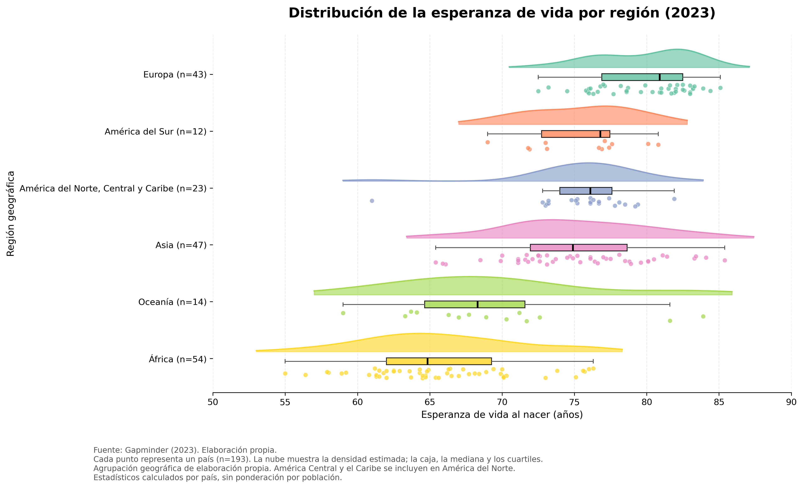
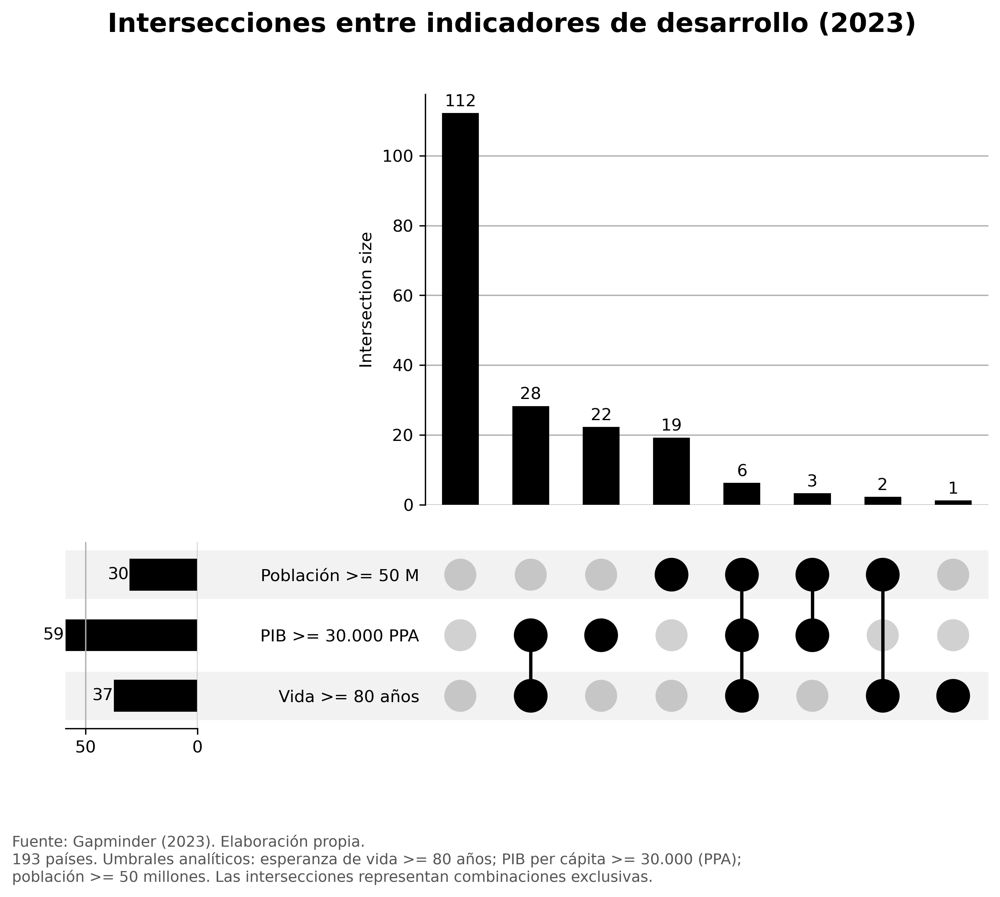

# PEC2 — Visualización de Datos

**Máster Universitario en Ciencia de Datos — Universitat Oberta de Catalunya (UOC)**

**Autor:** Fernando Esteban Sacco  
**Año:** 2026

## 1. Descripción del proyecto

Este repositorio contiene tres visualizaciones de datos elaboradas a partir de indicadores socioeconómicos y demográficos de Gapminder correspondientes al año 2023.

El análisis comprende **193 países** y utiliza tres técnicas de visualización complementarias:

1. **Bubble Chart:** relación entre desarrollo económico, esperanza de vida y población.
2. **Raincloud Plot:** comparación de las distribuciones de esperanza de vida entre regiones geográficas.
3. **UpSet Plot:** análisis de intersecciones entre indicadores de desarrollo.

El objetivo es explorar diferentes perspectivas de un mismo conjunto de datos y aplicar técnicas visuales adecuadas a distintas preguntas analíticas.

## 2. Visualizaciones

### Técnica I — Bubble Chart

**Desarrollo económico y esperanza de vida en 193 países (2023)**

Gráfico interactivo elaborado mediante Flourish.

- Eje horizontal: PIB per cápita ajustado por paridad de poder adquisitivo (PPA), en escala logarítmica.
- Eje vertical: esperanza de vida al nacer, expresada en años.
- Tamaño de las burbujas: población de cada país.
- Unidad de análisis: país.

Esta visualización permite explorar la asociación entre el nivel económico y la esperanza de vida, así como identificar países que se apartan de la tendencia general.

**[Consultar visualización interactiva en Flourish](https://public.flourish.studio/visualisation/30742523/)**

### Técnica II — Raincloud Plot

**Distribución de la esperanza de vida por región geográfica (2023)**

Visualización desarrollada con Python.

Combina tres elementos:

- Curvas de densidad para representar la forma estimada de cada distribución.
- Diagramas de caja para mostrar medianas, cuartiles y dispersión.
- Puntos individuales para representar los países analizados.

Se comparan seis agrupaciones geográficas: Europa, América del Sur, América del Norte, Central y Caribe, Asia, Oceanía y África.

Los estadísticos se calculan por país, sin ponderación por población.

### Técnica III — UpSet Plot

**Intersecciones entre indicadores de desarrollo (2023)**

Visualización desarrollada con Python utilizando la biblioteca UpSetPlot.

Se analizan tres conjuntos definidos mediante los siguientes umbrales:

- Esperanza de vida de al menos 80 años.
- PIB per cápita de al menos 30.000, ajustado por PPA.
- Población de al menos 50 millones de habitantes.

El gráfico permite identificar las combinaciones exclusivas de pertenencia a estos conjuntos.

Entre los resultados obtenidos, **6 países cumplen simultáneamente los tres criterios**, mientras que **112 no cumplen ninguno**.

Los umbrales son criterios analíticos establecidos para esta actividad y no constituyen una clasificación oficial del desarrollo de los países.

## 3. Datos utilizados

**Fuente:** Gapminder  
**Año de referencia:** 2023  
**Cobertura:** 193 países

Variables principales:

| Variable | Descripción |
|---|---|
| `geo` | Código del país |
| `name` | Nombre del país |
| `anio` | Año de referencia |
| `pib_per_capita` | PIB per cápita ajustado por PPA |
| `esperanza_vida` | Esperanza de vida al nacer |
| `poblacion` | Población del país |
| `region` | Agrupación geográfica utilizada en el análisis |

El archivo CSV utilizado se encuentra disponible en este repositorio.

## 4. Herramientas y tecnologías

- **Flourish:** visualización interactiva de burbujas.
- **Python:** procesamiento y representación de datos.
- **Jupyter Notebook:** desarrollo y documentación del análisis.
- **pandas:** manipulación y análisis de datos.
- **NumPy y SciPy:** operaciones numéricas y estimación de densidades.
- **Matplotlib y Seaborn:** construcción y personalización de gráficos.
- **UpSetPlot:** visualización de intersecciones entre conjuntos.
- **GitHub:** publicación del código y los archivos.
- **GitHub Pages:** presentación web de los resultados.

## 5. Archivos del repositorio

| Archivo | Contenido |
|---|---|
| `index.html` | Página web de presentación |
| `PEC2_Raincloud_Gapminder_2023.ipynb` | Notebook con el análisis y los gráficos Raincloud y UpSet |
| `PEC2_Raincloud_Gapminder_2023_Regiones.csv` | Datos utilizados |
| `PEC2_Raincloud_Gapminder_2023.png` | Imagen del Raincloud Plot |
| `PEC2_UpSet_Gapminder_2023.png` | Imagen del UpSet Plot |
| `README.md` | Documentación del proyecto |

## 6. Acceso a los resultados

**[Ver la página web de la PEC2](https://fenosacco.github.io/UOC-PEC2-Visualizacion-Datos/)**

**[Ver el Bubble Chart interactivo](https://public.flourish.studio/visualisation/30742523/)**

**[Consultar el notebook Jupyter](PEC2_Raincloud_Gapminder_2023.ipynb)**

## 7. Consideraciones metodológicas

Las visualizaciones presentan un análisis descriptivo y exploratorio.

La asociación observada entre PIB per cápita y esperanza de vida no implica necesariamente una relación causal.

Las comparaciones regionales del Raincloud Plot consideran cada país como una observación individual, independientemente de su población.

Los umbrales del UpSet Plot se han seleccionado para estudiar la pertenencia simultánea a distintos conjuntos y deben interpretarse dentro de este contexto.

Las agrupaciones regionales utilizadas son de elaboración propia.

---

**Fuente de datos:** Gapminder (2023).  
**Elaboración:** Fernando Esteban Sacco.  
**Actividad académica:** PEC2 — Visualización de Datos, UOC.
